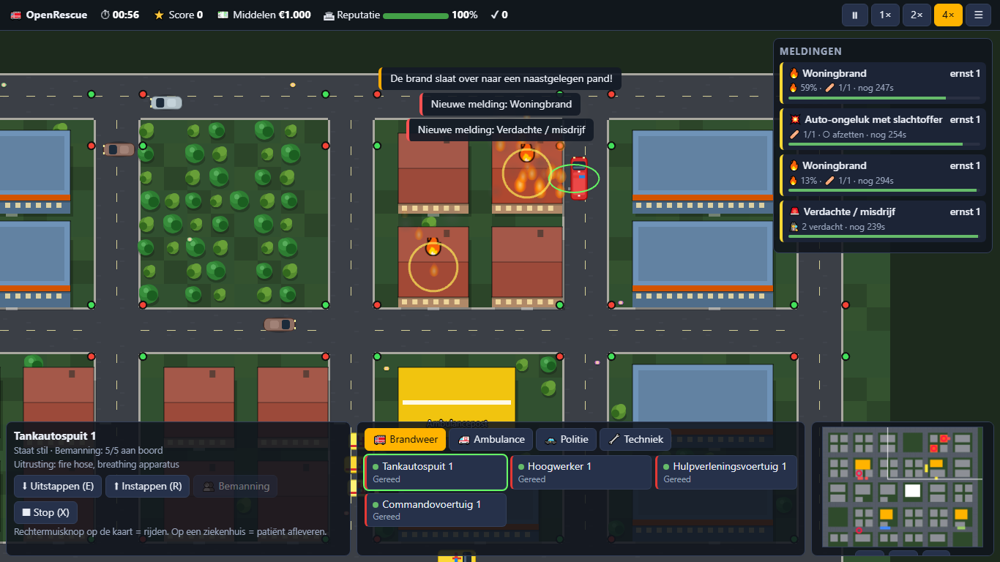

# 🚒 OpenRescue RTS

[](LICENSE) [](https://ko-fi.com/proadmin007)

Een open source hulpdienstensimulatie in de browser, geïnspireerd op de spelprincipes van Emergency 4: stuur brandweer, ambulance, politie en technische dienst naar dynamische incidenten in een levende stad.
Alles (code én graphics) is eigen werk; er zijn geen assets of code uit Emergency 4 gebruikt.



## Starten

```
npm install
npm run dev            # http://localhost:5173
```

Productie met Docker (Nginx):

```
docker compose up -d --build     # http://localhost:8080
```

(De Docker-bestanden zijn geschreven maar in de ontwikkelomgeving niet uitgeprobeerd: daar was geen Docker beschikbaar.)

## Spelen

| Actie | Bediening |
| --- | --- |
| Camera | WASD / pijltjes, middelste muisknop slepen, scrollwiel = zoom, minimap klikken |
| Selecteren | klik op eenheid, sleep een kader (Shift = toevoegen), knoppen onderin |
| Opdracht | rechtermuisknop: rijden / lopen, of gericht op brand, slachtoffer, verdachte, obstakel, ziekenhuis |
| Uitstappen / instappen / stop | `E` / `R` / `X` of de knoppen in het eenheidspaneel |
| Pauze, snelheid | `Spatie`, `1` `2` `3` of de knoppen rechtsboven |

Voorbeeld: selecteer de tankautospuit → rechtermuisknop op de brandende woning → **Uitstappen** → **Blussen** (of rechtermuisknop op de brand) → de melding verdwijnt zodra het vuur uit is.
Een ongeluk: ambulancepersoneel behandelt het slachtoffer (rechtermuisknop), laadt het in (nogmaals rechtermuisknop), stapt in en rijdt naar het ziekenhuis; de politie zet de plaats af.

Modi: **Nieuw spel** (korte scripted start, daarna Freeplay), **Freeplay** (easy / normal / hard, seed voor reproduceerbare scenario's), opslaan/laden via het pauzemenu.

## Wat er werkt

Zie [docs/architecture.md](docs/architecture.md). Kort: een kaart van 64×48 tegels met 72 gebouwen, vier posten + ziekenhuis, 13 voertuigtypes (15 voertuigen in de stad), 7 personeelsrollen,
6 incidenttypes (woningbrand, industriebrand, auto-ongeluk, medisch noodgeval, misdrijf, verkeersblokkade), brand met uitbreiding, slachtoffers met gezondheid en vervoer, A*-routes,
burgerverkeer met verkeerslichten en voorrang voor hulpdiensten, voetgangers, minimap, mod-systeem met validatie, opslaan/laden.

## Nog niet af

- Echte isometrische weergave (nu bovenaanzicht met 2.5D-gebouwen), geluid, animaties van personen.
- Naar binnen gaan in gebouwen (redden is een abstracte actie bij de deur), slangen als zichtbaar object, omstanders wegsturen, verkeer regelen, afzetlint tekenen.
- `coordinate`-rol (bevelvoerder) heeft nog geen effect; "Middelen" is nu alleen een scoremaat.
- Mods kunnen kaarten bevatten, maar het menu kiest nog geen andere kaart; geen Tiled-import.
- 60 FPS is niet gemeten op een echte GPU (zie [docs/performance.md](docs/performance.md)).
- Multiplayer (de simulatie is er wel op voorbereid).

## Ontwikkelen

```
npm test               # Vitest: pathfinding, incidenten, brand, eenheden, opslaan, validatie
npm run test:e2e       # Playwright (Chrome)
npm run build
npm run bench
```

Nieuwe voertuigen, rollen, incidenten of kaarten toevoegen: [docs/modding.md](docs/modding.md). Bijdragen: [CONTRIBUTING.md](CONTRIBUTING.md). Onderzoek: [docs/research.md](docs/research.md). Licenties van afhankelijkheden: [THIRD_PARTY.md](THIRD_PARTY.md).

De eerste, simpele canvas-prototype van dit project staat nog in [`legacy/`](legacy/).

## ☕ Support

<a href="https://ko-fi.com/proadmin007"></a>

## Licentie

MIT, zie [LICENSE](LICENSE).
