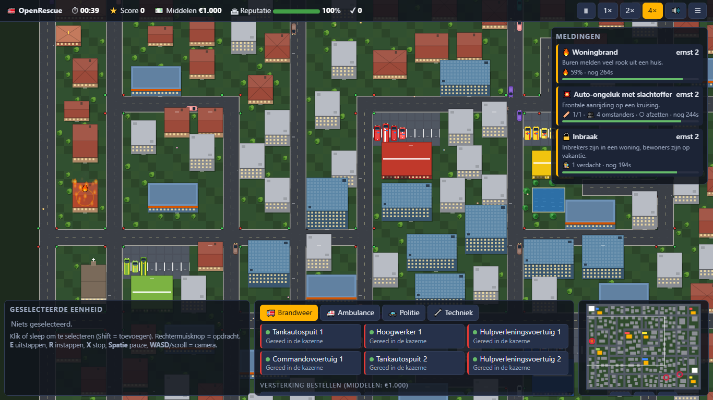
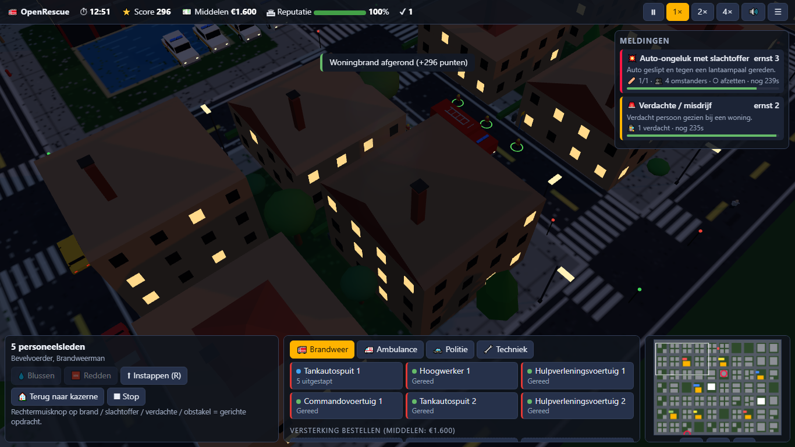
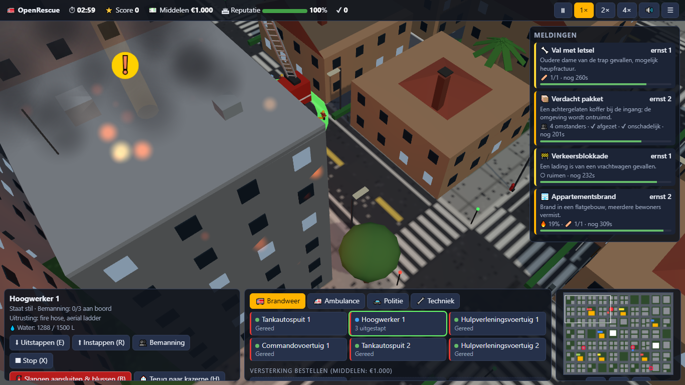
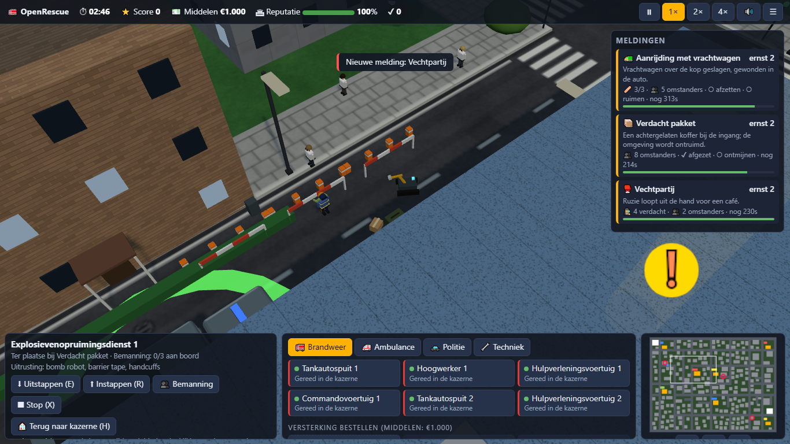

<div align="center">

# 🚒 OpenRescue RTS

**A free, open-source emergency-services strategy game that runs in your browser.**
Command fire engines, ambulances, police cars and tow trucks in a living city — an *Emergency 4*–inspired spiritual successor built with TypeScript and Phaser 4.

[](LICENSE)
[](https://github.com/ProAdmin007/Open-EM4/actions/workflows/ci.yml)
[](tsconfig.json)
[](https://phaser.io)
[](tests)
[](https://ko-fi.com/proadmin007)

**English** · [Nederlands](README.nl.md)



</div>

## What is OpenRescue RTS?

OpenRescue RTS is a real-time strategy game about running a city's **fire brigade, ambulance service, police and technical rescue**. Calls come in – house fires, cardiac arrests, pile-ups, burglaries, fallen trees – and you decide who goes where, who gets out of the vehicle, who fights the fire, who treats the patient, and which hospital gets the casualty.

It is inspired by the gameplay of *Emergency 4* (2006), but it is an **independent project with its own code, graphics and sound** – no assets, code or text from Emergency 4 are used. Everything is generated at runtime, so the whole game is MIT licensed and there is nothing to download except the game itself.

> Looking for an **Emergency 4 alternative that runs in the browser**, a **free firefighter / ambulance / police management game**, or an **open-source RTS to learn from or mod**? That is what this is.

## Features

- 🏙️ **A big living city** – 102 × 72 tiles, 160+ buildings in 11 kinds (houses, flats, offices, mall, school, church, warehouses, factories…), five districts, parks with ponds, civilian traffic with traffic lights, pedestrians.
- 🚒🚑🚓🔧 **13 vehicle types and 7 crew roles** – tanker, aerial ladder, rescue and command vehicles; ambulance, rapid responder, MMT car; patrol car, van, motorcycle; tow truck, service van, crane. Crew gets out, rolls out hoses, rescues, treats, carries, arrests, secures scenes, disperses crowds and clears wrecks.
- 🔥 **26 kinds of incidents** with their own descriptions: house, kitchen, apartment, office/school, industrial and warehouse fires · cardiac arrest, fall, choking, childbirth, allergic reaction, stroke · car, motorcycle, pedestrian and truck accidents · burglary, fight, armed robbery, vandalism · blockades, fallen trees and broken-down trucks.
- 🧯 **Realistic firefighting** – every engine carries a water tank (it runs dry!) and hooks up to street hydrants to refill; fires in tall buildings need the aerial ladder (without it your crews only get 40% effect), and the 3D view raises and turns the ladder towards the fire.
- 🤖 **Bomb squad** (inspired by the Los Angeles mod) – a *suspicious package* incident: secure the area with tape, cones, barriers and flares, send the crowd away and let the bomb-disposal crew roll out the robot.
- ⏱️ **Severity matters** – treatment, arrest, securing, clearing and fire-fighting times grow with the severity, differ per incident type, and unattended incidents escalate and eventually fail.
- 🚦 **Believable traffic** – right-hand lanes, U-turns, emergency vehicles that never overlap other vehicles or people, parking bays at every station, and crews that step out *beside* the vehicle.
- 🔊 **Fully procedural audio** – Dutch-style two-tone sirens, crackling fire, water spray, traffic hum and UI effects, all synthesised with the Web Audio API (no sound files).
- 🎯 **Game modes** – six missions, endless Freeplay (Easy / Normal / Hard, seeded for reproducible scenarios), save & load, local highscores.
- 🧩 **Moddable** – vehicles, roles, incidents, missions and maps are validated JSON; an example content pack is included.
- 🧪 **Well tested** – deterministic simulation with 94 unit tests and 16 Playwright browser tests (including the full "drive to a fire, dismount, extinguish, incident disappears" scenario, in both the 2D and 3D views).
- 🧊 **Experimental 3D view** – a procedural three.js city (buildings, vehicles, people, fire/smoke, traffic lights) with an RTS camera, next to the original 2D view; switch in Settings or the main menu. Lazily loaded, so it costs nothing if you never turn it on ([docs/3d.md](docs/3d.md)).

The experimental 3D view (procedural three.js, no external assets):

<p align="center">  </p>

<p align="center"> </p>

<p align="center">  </p>

## Play it

**Requirements:** [Node.js](https://nodejs.org) 20+ and a modern browser with WebGL (developed and tested with Chrome).

```bash
git clone https://github.com/ProAdmin007/Open-EM4.git
cd Open-EM4
npm install
npm run dev          # opens http://localhost:5173
```

Other ways to run it:

| Way | Command |
| --- | --- |
| Production build | `npm run build && npm run preview` → <http://localhost:4173> |
| Docker + Nginx | `docker compose up -d --build` → <http://localhost:8080> *(files provided, not tested in the dev environment)* |
| Windows app (Electron) | `npm run package:win` → `dist-app/OpenRescue-win32-x64/OpenRescue.exe` |

The game UI is in Dutch; the code, comments and documentation are in English.

## How to play

| Action | Control |
| --- | --- |
| Camera | `WASD` / arrow keys, middle-mouse drag, mouse wheel to zoom, click the minimap |
| Select | click a unit, drag a box (`Shift` adds), or use the dispatch bar |
| Order | right-click: drive / walk, or a targeted action on a fire, casualty, suspect, obstacle, crowd or hospital |
| Get out / in / stop | `E` / `R` / `X`, or double right-click a vehicle to let everybody out |
| Fire brigade | `B` = connect hoses and start fighting the nearest fire |
| Ambulance with a patient | `Z` = drive to the hospital (crew boards first) |
| Back to the station | `H` |
| Pause, speed, sound | `Space`, `1` `2` `3`, `M` |

**Example:** select the fire engine → right-click the burning house → press `B` (crew gets out, rolls out the hoses, extinguishes) → the call disappears when the fire is out and nobody is left inside. For an accident: paramedics treat the casualty (right-click), carry them to the ambulance (right-click again), board, press `Z`; police secure the scene and send bystanders away.

Earn points and budget by resolving calls quickly, spend the budget on **reinforcements**, and keep your reputation above zero.

## Under the hood

- **TypeScript (strict), Phaser 4, Vite, Vitest, Playwright**; DOM HUD; Web Audio; no backend required.
- `src/sim` – a deterministic, headless simulation on a fixed 30 Hz time step: A\* pathfinding, lanes and collision avoidance (oriented-box separating-axis tests), fire spread, casualties, incidents, missions, save/load. Seeded RNG.
- `src/game` – rendering, input, particles, audio. `src/ui` – Dutch HUD and menus.
- JSON content in `src/data`, a city generator in `tools/genmap.mjs`, a headless benchmark in `tools/bench.ts`.

Read more: [architecture](docs/architecture.md) · [modding guide](docs/modding.md) · [3D plan](docs/3d.md) · [research notes](docs/research.md) · [performance](docs/performance.md) · [third-party licences](THIRD_PARTY.md).

## Modding

Add your own vehicles, incidents, missions or maps as JSON and load them from *Settings → Mods*. Errors are reported with the exact path. An example pack inspired by big-city scenarios lives in [`mods/la-style-pack.json`](mods/la-style-pack.json). See [docs/modding.md](docs/modding.md).

## Roadmap

- 3D renderer on top of the prepared snapshot/units API ([docs/3d.md](docs/3d.md))
- Entering buildings, traffic control by police, more crew animations
- Tiled map import, more missions and a campaign
- Multiplayer through an authoritative server (the simulation is already renderer-independent)

## FAQ

**Is this Emergency 4?** No. It is an independent, open-source game inspired by the genre. It contains no Emergency 4 code or assets.

**Is it free?** Yes – MIT licensed, no ads, no accounts, no tracking. Your settings and savegames stay in your browser's local storage.

**Does it need an internet connection?** Only to download it. Once built, it runs completely offline.

**Which browsers work?** Anything with WebGL. It is developed and tested in Chrome; Edge and Firefox should work too. There is no touch/mobile support yet.

**Can I make my own content?** Yes, see the modding guide.

## Contributing

Issues and pull requests are welcome – see [CONTRIBUTING.md](CONTRIBUTING.md). Please keep the simulation deterministic and add a test for every change.

```bash
npm test             # unit and simulation tests
npm run test:e2e     # browser tests (Playwright, uses your installed Chrome)
npm run bench        # headless simulation benchmark
```

## ☕ Support

If you enjoy the project, you can support its development:

<a href="https://ko-fi.com/proadmin007"></a>

## License

[MIT](LICENSE) – the code and all generated assets. See [THIRD_PARTY.md](THIRD_PARTY.md) for dependencies.

<sub>Keywords: emergency 4 alternative, browser emergency game, firefighter game, ambulance game, police game, 112 game, hulpdienstenspel, brandweer spel, open source RTS, emergency services simulation, TypeScript game, Phaser 4 game.</sub>
