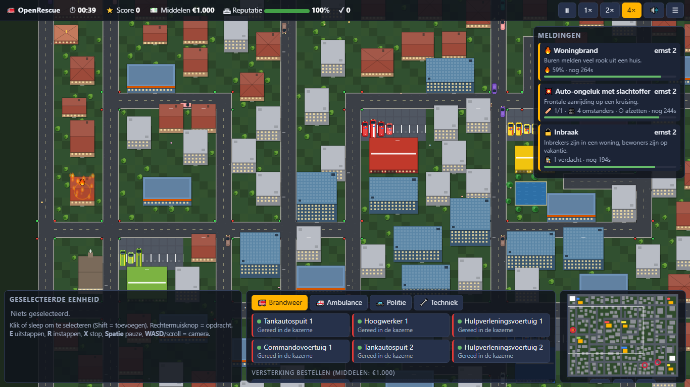
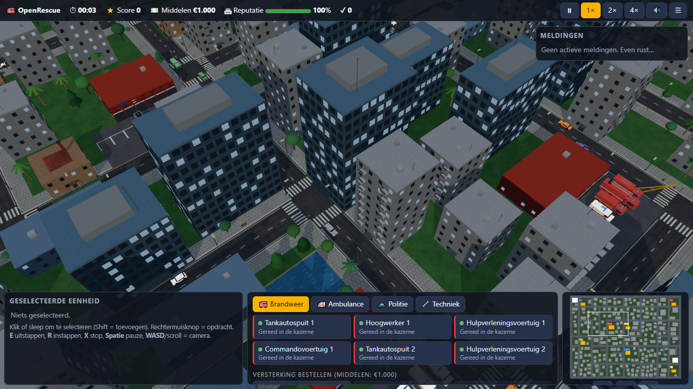
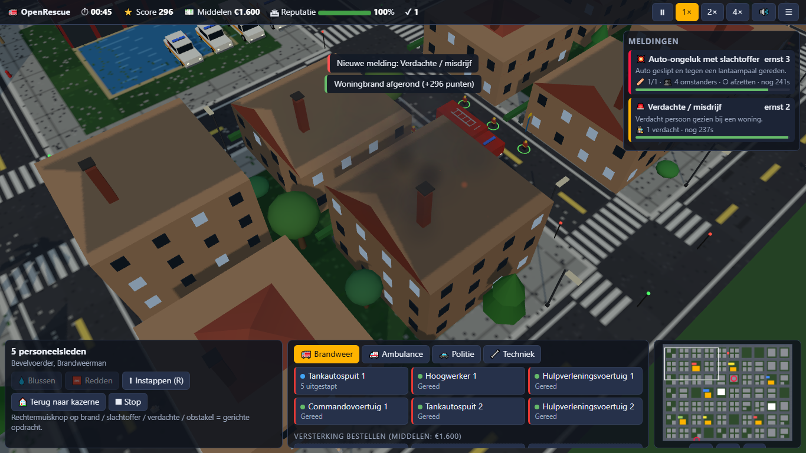
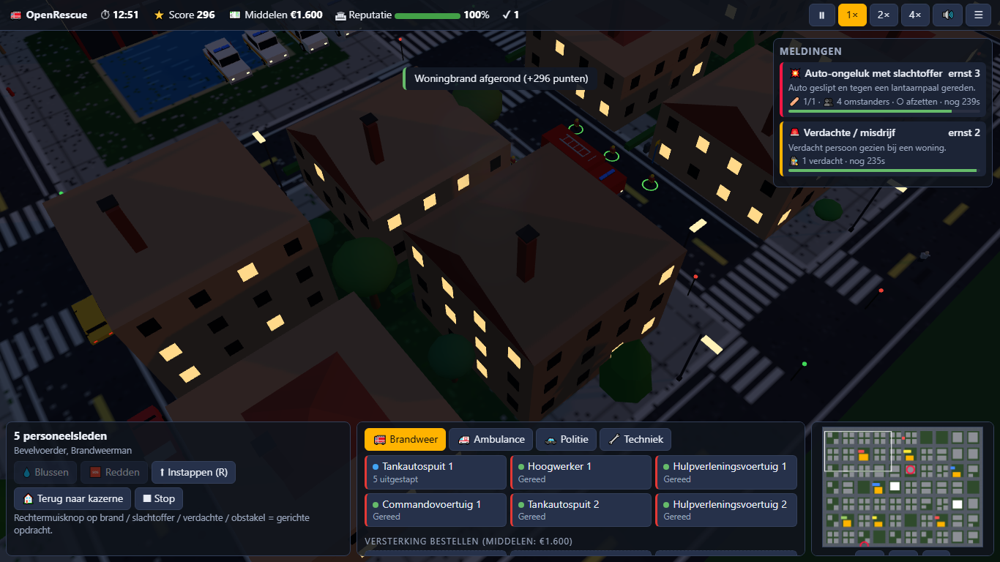
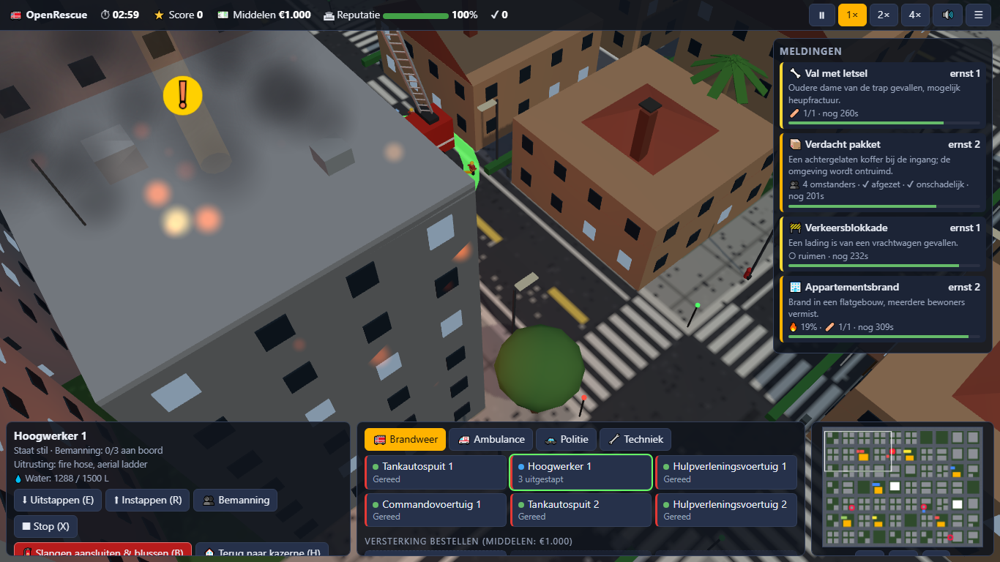
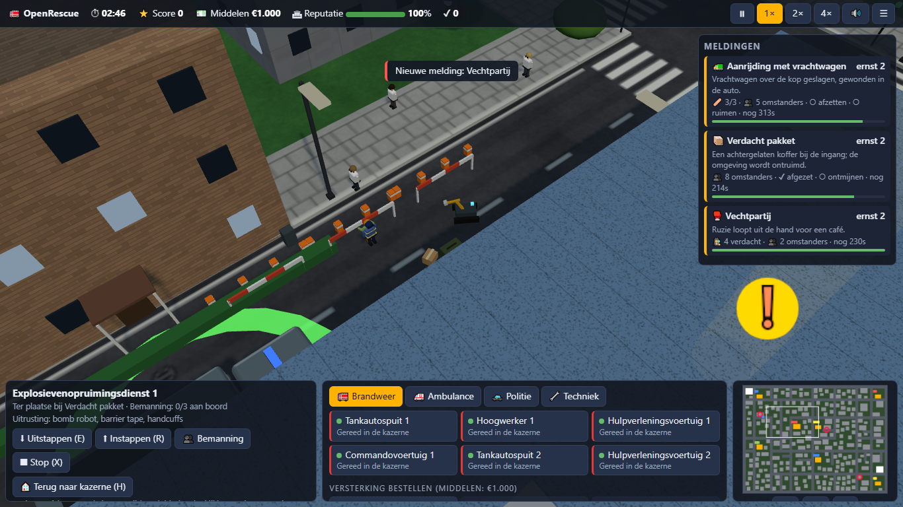
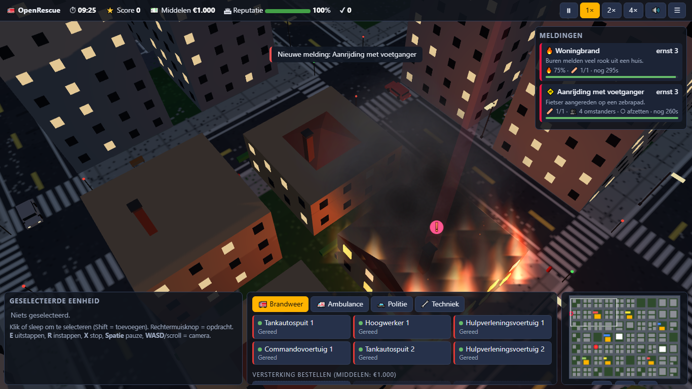
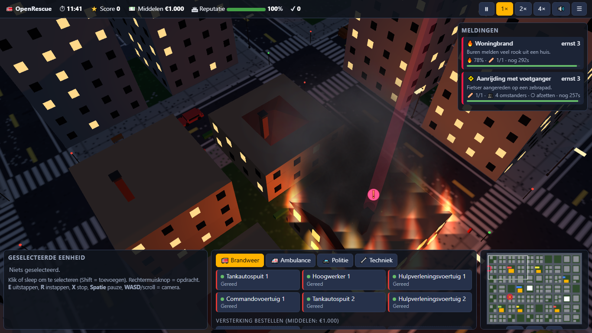
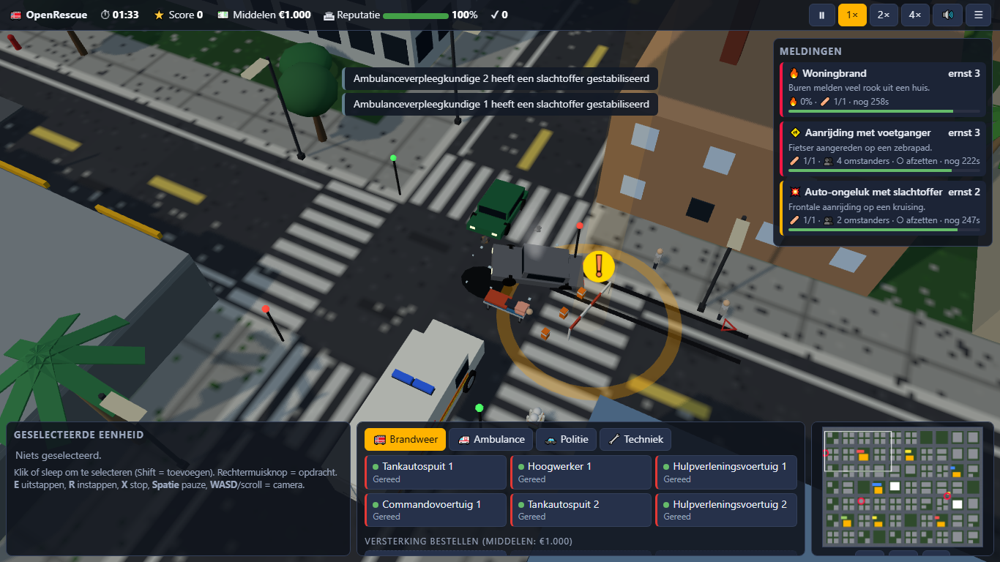

<div align="center">

# 🚒 OpenRescue RTS

**Een gratis, open source hulpdienstenspel dat gewoon in je browser draait.**
Stuur brandweer, ambulances, politie en bergingsvoertuigen aan in een levende stad — een geestelijke opvolger van *Emergency 4*, gebouwd met TypeScript en Phaser 4.

[](LICENSE)
[](https://github.com/ProAdmin007/Open-EM4/actions/workflows/ci.yml)
[](tsconfig.json)
[](https://phaser.io)
[](tests)
[](https://ko-fi.com/proadmin007)

[English](README.md) · **Nederlands**



</div>

## Wat is OpenRescue RTS?

OpenRescue RTS is een realtime strategiespel waarin jij de **brandweer, ambulancedienst, politie en technische hulpverlening** van een stad aanstuurt. De meldingen stromen binnen – woningbranden, hartstilstanden, kettingbotsingen, inbraken, omgevallen bomen – en jij beslist wie waarheen rijdt, wie uitstapt, wie de brand blust, wie de patiënt behandelt en naar welk ziekenhuis het slachtoffer gaat.

Het spel is geïnspireerd op de gameplay van *Emergency 4* (2006), maar is een **onafhankelijk project met eigen code, graphics en geluid**. Er is niets uit Emergency 4 gebruikt. Alles wordt tijdens het spelen gegenereerd, dus het hele spel valt onder de MIT-licentie.

> Zoek je een **Emergency 4-alternatief in de browser**, een **gratis brandweer-, ambulance- en politiespel** of een **open source RTS om van te leren of te modden**? Dan ben je hier goed.

## Functies

- 🏙️ **Een grote, levende stad** – 102 × 72 tegels, ruim 160 gebouwen in 11 soorten (woningen, flats, kantoren, winkelcentrum, school, kerk, loodsen, fabrieken…), vijf wijken, parken met vijvers, burgerverkeer met verkeerslichten en voetgangers.
- 🚒🚑🚓🔧 **13 voertuigtypes en 7 rollen** – tankautospuit, hoogwerker, hulpverlenings- en commandovoertuig; ambulance, rapid responder, MMT; surveillancewagen, bus, motor; bergingswagen, monteursvoertuig, kraan. De bemanning stapt uit, rolt slangen uit, redt, behandelt, draagt, arresteert, zet af, stuurt omstanders weg en ruimt wrakken.
- 🔥 **26 soorten meldingen**, elk met eigen omschrijving: woning-, keuken-, appartements-, kantoor/school-, industrie- en loodsbrand · hartstilstand, val, verslikking, bevalling, allergische reactie, beroerte · auto-, motor-, voetgangers- en vrachtwagenongelukken · inbraak, vechtpartij, gewapende overval, vandalisme · blokkades, omgevallen bomen en pech met vrachtwagens.
- 🧯 **Realistisch blussen** – elke tankautospuit heeft een watertank (die raakt leeg!) en sluit aan op brandkranen om bij te vullen; branden in hoogbouw vragen om de hoogwerker (zonder is het effect maar 40%), en in 3D klapt de ladder uit richting de brand.
- 🤖 **Explosievenopruiming** (geïnspireerd door de Los Angeles-mod) – de melding *verdacht pakket*: zet het gebied af met lint, pylonen, afzethekken en fakkels, stuur omstanders weg en laat de EOD-ploeg de robot inzetten.
- ⏱️ **Ernst telt** – behandel-, arrestatie-, afzet-, ruim- en bluswerk duren langer naarmate de ernst stijgt en verschillen per soort melding. Een melding die je negeert escaleert en mislukt uiteindelijk.
- 🚦 **Geloofwaardig verkeer** – rechts rijden, keren op de weg, hulpdiensten die nooit door andere voertuigen of mensen heen rijden, parkeervakken bij elke post en bemanning die *naast* het voertuig uitstapt.
- 🔊 **Volledig gegenereerd geluid** – Nederlandse tweetonige sirenes, knetterend vuur, waterstralen, verkeer en interface-effecten, allemaal met de Web Audio API (geen geluidsbestanden).
- 🎯 **Spelmodi** – zes missies, eindeloze Freeplay (Easy / Normal / Hard, met seed voor reproduceerbare scenario's), opslaan en laden, lokale highscores.
- 🧩 **Moddable** – voertuigen, rollen, meldingen, missies en kaarten zijn gevalideerde JSON; er zit een voorbeeldpakket bij.
- 🧪 **Goed getest** – een deterministische simulatie met 94 unit-tests en 16 browsertests (Playwright), waaronder het complete scenario "rij naar een brand, stap uit, blus, melding verdwijnt" in zowel de 2D- als de 3D-weergave.
- 🧊 **Experimentele 3D-weergave** – een procedurele three.js-stad (gebouwen, voertuigen, mensen, vuur/rook, verkeerslichten) met een RTS-camera, naast de originele 2D-weergave; omschakelen via Instellingen of het hoofdmenu. Wordt pas geladen zodra je hem aanzet, dus kost niets als je hem nooit gebruikt ([docs/3d.md](docs/3d.md)).

De experimentele 3D-weergave (procedureel, three.js, geen externe assets):

<p align="center">  </p>

<p align="center"> </p>

<p align="center">  </p>

## Spelen

**Vereist:** [Node.js](https://nodejs.org) 20+ en een moderne browser met WebGL (ontwikkeld en getest met Chrome).

```bash
git clone https://github.com/ProAdmin007/Open-EM4.git
cd Open-EM4
npm install
npm run dev          # opent http://localhost:5173
```

Andere manieren:

| Manier | Commando |
| --- | --- |
| Productiebuild | `npm run build && npm run preview` → <http://localhost:4173> |
| Docker + Nginx | `docker compose up -d --build` → <http://localhost:8080> *(bestanden zijn aanwezig, niet getest in de ontwikkelomgeving)* |
| Windows-app (Electron) | `npm run package:win` → `dist-app/OpenRescue-win32-x64/OpenRescue.exe` |

## Bediening

| Actie | Besturing |
| --- | --- |
| Camera | `WASD` / pijltjes, middelste muisknop slepen, scrollwiel = zoom, minimap klikken |
| Selecteren | klik op een eenheid, sleep een kader (`Shift` = toevoegen) of gebruik de balk onderin |
| Opdracht | rechtermuisknop: rijden / lopen, of een gerichte actie op brand, slachtoffer, verdachte, obstakel, menigte of ziekenhuis |
| Uit- / instappen / stop | `E` / `R` / `X`, of dubbel rechtsklikken op een voertuig om iedereen uit te laten stappen |
| Brandweer | `B` = slangen aansluiten en de dichtstbijzijnde brand gaan blussen |
| Ambulance met patiënt | `Z` = naar het ziekenhuis (bemanning stapt eerst in) |
| Terug naar de kazerne | `H` |
| Pauze, snelheid, geluid | `Spatie`, `1` `2` `3`, `M` |

**Voorbeeld:** selecteer de tankautospuit → rechtermuisknop op de brandende woning → druk op `B` (de bemanning stapt uit, rolt slangen uit en blust) → de melding verdwijnt zodra het vuur uit is en er niemand meer binnen is. Bij een ongeluk: ambulancepersoneel behandelt het slachtoffer (rechtermuisknop), draagt het naar de ambulance (nogmaals rechtermuisknop), stapt in en je drukt op `Z`; de politie zet de plaats af en stuurt omstanders weg.

Verdien punten en budget door meldingen snel op te lossen, bestel **versterking** en houd je reputatie boven nul.

## Onder de motorkap

- **TypeScript (strict), Phaser 4, Vite, Vitest, Playwright**; HUD in de DOM; Web Audio; geen backend nodig.
- `src/sim` – een deterministische simulatie zonder weergavecode, vaste tijdstap van 30 Hz: A\*-routes, rijstroken en botsingspreventie, brandverspreiding, slachtoffers, meldingen, missies, opslaan/laden. Seeded RNG.
- `src/game` – weergave, invoer, deeltjes, geluid. `src/ui` – Nederlandse HUD en menu's.
- JSON-content in `src/data`, stadsgenerator in `tools/genmap.mjs`, benchmark in `tools/bench.ts`.

Meer lezen: [architectuur](docs/architecture.md) · [modding](docs/modding.md) · [3D-plan](docs/3d.md) · [onderzoek](docs/research.md) · [prestaties](docs/performance.md) · [licenties](THIRD_PARTY.md).

## Modding

Voeg eigen voertuigen, meldingen, missies of kaarten toe als JSON en laad ze via *Instellingen → Mods*. Fouten worden met het exacte pad gemeld. Een voorbeeldpakket staat in [`mods/la-style-pack.json`](mods/la-style-pack.json). Zie [docs/modding.md](docs/modding.md).

## Plannen

- 3D-weergave op basis van de voorbereide snapshot- en eenhedenlaag ([docs/3d.md](docs/3d.md))
- Gebouwen binnengaan, verkeer regelen door de politie, meer animaties
- Tiled-import, meer missies en een campagne
- Multiplayer via een autoritatieve server (de simulatie is al onafhankelijk van de weergave)

## Veelgestelde vragen

**Is dit Emergency 4?** Nee. Het is een onafhankelijk open source spel dat door het genre is geïnspireerd. Er zit geen code of materiaal van Emergency 4 in.

**Is het gratis?** Ja – MIT-licentie, geen advertenties, geen account, geen tracking. Instellingen en savegames blijven in de lokale opslag van je browser.

**Heb ik internet nodig?** Alleen om het te downloaden. Eenmaal gebouwd draait het volledig offline.

**Welke browsers werken?** Alles met WebGL. Ontwikkeld en getest in Chrome; Edge en Firefox zouden moeten werken. Er is nog geen touch/mobiele ondersteuning.

**Kan ik eigen content maken?** Ja, zie de modding-handleiding.

## Bijdragen

Issues en pull requests zijn welkom – zie [CONTRIBUTING.md](CONTRIBUTING.md). Houd de simulatie deterministisch en voeg bij elke wijziging een test toe.

```bash
npm test             # unit- en simulatietests
npm run test:e2e     # browsertests (Playwright, gebruikt je geïnstalleerde Chrome)
npm run bench        # benchmark van de simulatie
```

## ☕ Support

Vind je het project leuk? Je kunt de ontwikkeling steunen:

<a href="https://ko-fi.com/proadmin007"></a>

## Licentie

[MIT](LICENSE) – de code en alle gegenereerde assets. Zie [THIRD_PARTY.md](THIRD_PARTY.md) voor afhankelijkheden.

<sub>Zoektermen: emergency 4 alternatief, hulpdienstenspel in de browser, brandweer spel, ambulance spel, politie spel, 112 spel, open source RTS, hulpdienstensimulatie, TypeScript game, Phaser 4 game.</sub>
